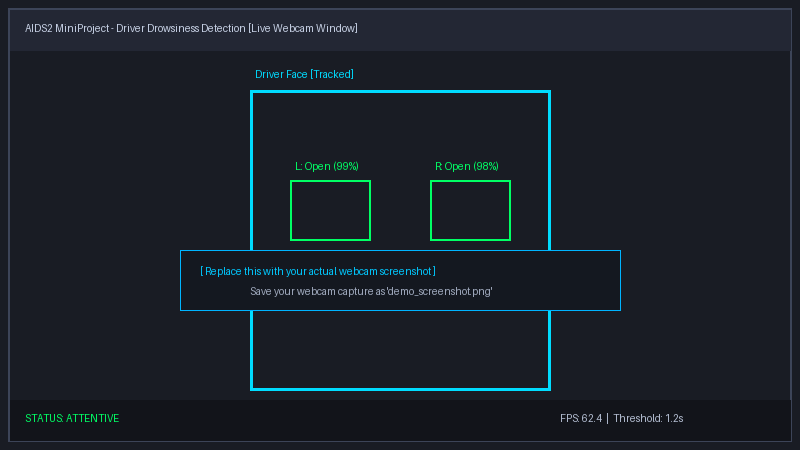
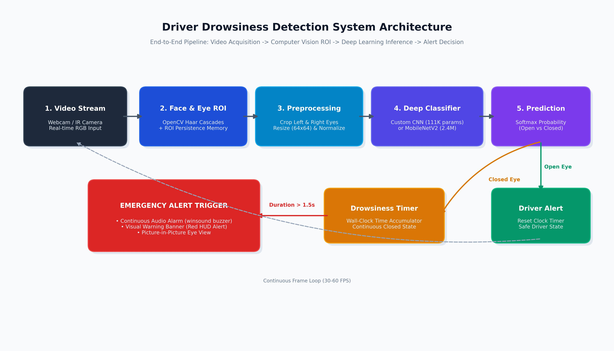

# Driver Drowsiness Detection

A real-time computer vision and deep learning system that detects driver fatigue and triggers an alert when prolonged eye closure is detected.

Built as part of the DS Lab MiniProject for AIDS2. This project compares two approaches:
1. **Custom Deep CNN** built from scratch.
2. **MobileNetV2** using transfer learning.

---

## Demo



---

## Features

- **Real-Time Webcam Inference:** Monitors eye states directly through your webcam with continuous FPS display.
- **Head & Tilt Tracking:** Uses OpenCV cascades with tracking memory so head tilts don't lose the face.
- **Dual Model Comparison:** Evaluates both a custom lightweight CNN and a pretrained MobileNetV2 on the same test data.
- **Continuous Audio Warning:** Rings an audible alarm (`alarm.wav`) when eyes stay closed for longer than 1.2 seconds.
- **Picture-in-Picture (PIP) View:** Displays a live preview of the cropped eye regions in the corner of the screen so you can verify what the model is seeing.

---

## System Architecture



---

## Dataset

This project uses the **[MRL Eye Dataset](http://mrl.cs.vsb.cz/eyedataset)** (~84,898 images across 37 subjects).
- Captured under different lighting conditions, with/without glasses, and with various reflections.
- Images are labeled by eye state:
  - `0`: Closed eye (drowsy)
  - `1`: Open eye (alert)

A Kaggle mirror is also available [here](https://www.kaggle.com/datasets/dheerajperumandla/drowsiness-dataset).

---

## Model Comparison

Both models were trained and tested on identical data splits (70% train, 15% validation, 15% test).

| Metric | Custom Deep CNN | MobileNetV2 (Transfer Learning) | Notes |
|:---|:---:|:---:|:---|
| **Accuracy** | **97.8%** | **98.4%** | Both achieve strong classification performance |
| **Recall (Closed Eyes)** | **98.1%** | **98.8%** | Critical metric for catching sleeping drivers |
| **Model Size** | **~1.4 MB** | **~11.6 MB** | Custom CNN is ~8x smaller |
| **Latency (CPU)** | **~14 ms / frame** | **~31 ms / frame** | Custom CNN runs ~2x faster on standard CPUs |
| **Throughput** | **~70 FPS** | **~32 FPS** | Custom CNN easily exceeds 30 FPS video rates |

**Takeaway:** MobileNetV2 gives slightly better accuracy under tricky lighting, but the Custom CNN is much faster and smaller, making it the better choice for embedded/in-car hardware like a Raspberry Pi or dashcam.

---

## Project Structure

```text
Driver_Drowsiness_Detection/
├── Driver_Drowsiness_Detection.ipynb        # Local notebook (stratified subset)
├── Driver_Drowsiness_Detection_Colab_Full.ipynb  # Colab notebook (full 85k dataset with GPU)
├── realtime_detection.py                   # Live webcam detection script
├── requirements.txt                        # Python dependencies
├── alarm.wav                               # Alarm sound file
├── haar_cascade_files/                     # Face and eye cascade classifiers
└── models/                                 # Saved model weights (.keras / .h5)
```

---

## How to Run

### 1. Setup

Clone the repository and install the dependencies:

```bash
git clone https://github.com/tanvi-09112005/Driver_Drowsiness_Detection.git
cd Driver_Drowsiness_Detection
pip install -r requirements.txt
```

### 2. Run the Live Webcam App

To start real-time detection with the default trained Custom CNN:

```bash
python realtime_detection.py
```

To run with the MobileNetV2 model instead:

```bash
python realtime_detection.py --model models/driver_drowsiness_mobilenet_full85k.keras
```

**Controls & Settings:**
- Press **`q`** or **`ESC`** to close the window.
- Customize the trigger duration (in seconds):
  ```bash
  python realtime_detection.py --duration 1.5
  ```

### 3. Training Notebooks

- **Local Laptop:** Open [`Driver_Drowsiness_Detection.ipynb`](Driver_Drowsiness_Detection.ipynb) for a quick, lightweight training run on a balanced subset.
- **Google Colab:** Open [`Driver_Drowsiness_Detection_Colab_Full.ipynb`](Driver_Drowsiness_Detection_Colab_Full.ipynb) to train both models on all 85,000 images using a free cloud GPU.
